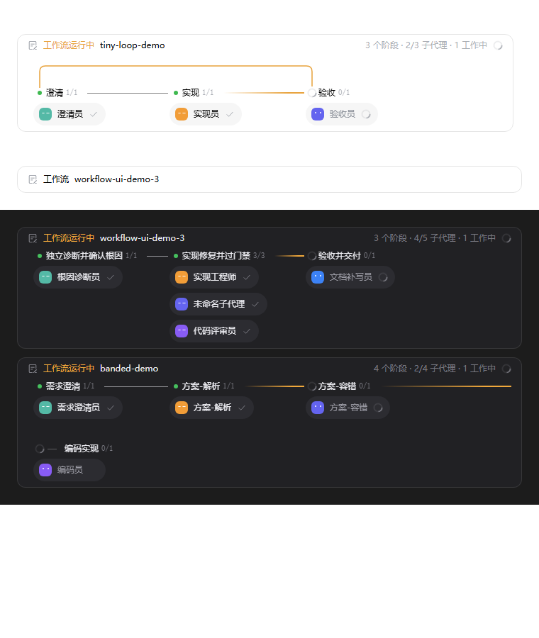

# dsh-workflow-ui

[](https://github.com/zuiyouli/dsh-workflow-ui/actions/workflows/ci.yml)
[](LICENSE)

DeepSeek Harness Web GUI 的对话内工作流运行时间线：把官方 `workflow` 工具卡与 `workflow-run` 聊天节点替换成横向时间线——轨道 + 阶段站 + 子代理药丸 + 循环弧线 + 并行带，且**开跑之前就能看到全部计划**。

English documentation in [README.en.md](README.en.md)。


窄窗口自动换行（同排弧 + ↩ 回边徽标）：



## 功能

- **对话内嵌卡片** — 每次 workflow 运行一张卡，长在对话流里，无需打开任何面板。
- **计划先行** — 客户端扫描 workflow 脚本（`phase()` 调用、`parallel()` 块、阶段回访），开跑前就渲染出全部计划站点、药丸占位与依赖弧线。
- **并行带** — `parallel()` 阶段渲染为抬升轨道，fork/merge 接头为圆角弧。
- **弧线** — 非相邻前向边与循环回边在轨道上空飞行：弧道按跨度分配（短跨低道、相交上推）、8px 圆角拐点、落地箭头；落入运行中站点的弧点亮为 march。宽屏画完整弧线；窄屏换行时只画同排弧，跨排回边由 `↩` 徽标承担。
- **药丸折叠** — 单站超过 5 个子代理自动折叠为「＋N」展开片；展开状态跨实时刷新保留；隐藏药丸里有运行中的会在折叠片上闪呼吸点。
- **药丸跳转子会话** — 点击药丸按 DSH 0.2.1 契约（`openSession({parentSessionId, childSessionId, mode})`，mode 传 `unknown` 由工作区自行解析）直达对应子会话；支持键盘聚焦与 Enter 触发。
- **自带 agent 预设** — 安装即向名册添加 `Workflow 编排` 预设（标准全量工具 + "多步任务主动用 workflow"的 persona 指引），卸载即移除。
- **DSH 官方图标** — StateDot 状态点（done/error = 6px 实心核，running = 中性 spinner 弧，pending = idle 点）、官方 ListPen 卡头图标、1px Check/Close 标记。
- **子代理药丸** — 逐 agent 状态 + 表情（运行中张望/眨眼），结算勾，未启动的计划占位。
- **主题与无障碍** — 经 DSH 别名 token 适配亮/暗主题，全链路尊重 `prefers-reduced-motion`，状态字形带 `aria` 标签。

## 安装

```bash
dsh plugin --profile web add github:zuiyouli/dsh-workflow-ui
```

安装后重启一次 dsh（组合变更），再刷新页面。要求 DSH `>=0.1.0-rc.5`；已在 `0.2.0-rc.2` 与 `0.2.1-rc.2` 实测，web profile。

装好后建议切换到自带的 **Workflow 编排** 预设（新会话选择器里），模型会对多步任务主动使用 workflow 编排。

## 原理

两个 keyed 槽位以 `priority: -1` 影子官方渲染器（官方默认 `0`，priority 最低者渲染；本组件崩溃会自动 abdicate 回退官方）：

- `conversation.chat.node` key `workflow-run` — 数据来自官方 Definition 对持久化事件（`tool-workflow/run-start|agent-start|agent-end|run-end`）的投影，本插件只换呈现。
- `tool.call.toolview` key `workflow` — 渲染不可见标记（该行经 CSS `:has` 隐藏，0.2.1 起连同 turn-process 流程头一并隐藏），并把工具入参的脚本元数据 stash 进模块 store，供运行卡做计划先行渲染。

样式以 `<style data-plugin>` 一次性注入、卸载时移除；类名全部 `zcf-` 前缀。颜色落在 14 个局部 `--color-*` token，映射到 DSH `--dsw-alias-*`。

## 开发

零依赖，Node >= 20。

```bash
npm run check     # 语法检查 + 单元测试 + 构建 + lib 检查 + 门面冒烟
npm run preview   # 生成 docs/preview/preview.html（亮/暗卡片）
```

无头截图预览：

```bash
chrome --headless=new --virtual-time-budget=3000 --screenshot=shot.png docs/preview/preview.html
```

布局常量参考 ZCode 的公开工作流呈现设计（站宽 168 / 间距 192 / 灯心 +17，弧基 26 / 道距 14，6–8px 圆角接头，120/160/200/320ms 运动 token）。状态点与图标复现 DSH 官方 `dsh-client-ui-primitives` 的形制（StateDot、ListPen、Check、Close）。本插件与 ZCode、DSH 官方均无隶属关系。

## 路线图

迭代方向与版本主题见 [docs/roadmap.md](docs/roadmap.md)（下一版 v0.3.0：完成态折叠摘要 + 耗时/循环指标 + 失败复盘）。

## 边界说明

- 工具行只作为隐形数据源存在；时间线卡是会话中的唯一入口。
- 宽屏单排画完整弧线；换行模式只画同排弧，跨排依赖以 `↩` 徽标提示。
- 状态词为内置中文；运行指标与 locale 通道暂未接。
- 只读消费 workflow 事件，不保存任何平行编排状态。

## 许可

[MIT](LICENSE) © zuiyouli
