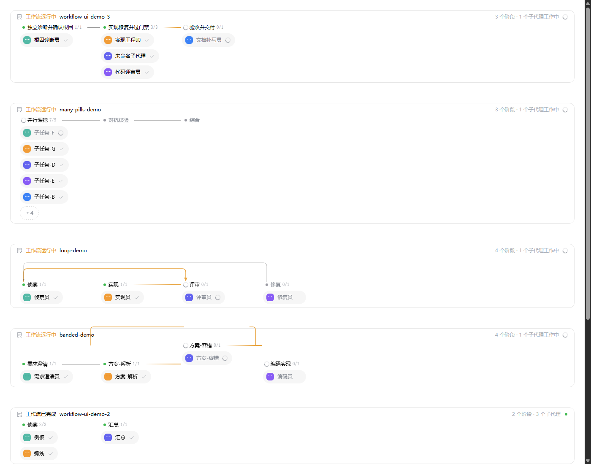

# dsh-workflow-ui

[](https://github.com/zuiyouli/dsh-workflow-ui/actions/workflows/ci.yml)
[](LICENSE)

An in-conversation workflow run timeline for the [DeepSeek Harness](https://github.com/deepseek-ai/deepseek-harness) web GUI. It replaces the stock `workflow` tool card and the `workflow-run` chat node with a horizontal timeline: a rail with phase stations, agent pills, loop arcs, parallel bands — and the full **plan is visible before the run reaches it**.

中文说明见 [README.zh.md](README.zh.md)。



## What you get

- **In-conversation card** — one card per workflow run, right in the chat flow. No panel to open, nothing to configure.
- **Plan-ahead rendering** — the card scans the workflow script client-side (`phase()` calls, `parallel()` blocks, revisited phases) and renders every planned station, pill placeholder and dependency arc before the run gets there.
- **Parallel bands** — `parallel()` phases become raised tracks with rounded fork/merge joins.
- **Arcs** — non-adjacent forward edges and loop (return) edges fly above the rail with lane assignment (short spans low, crossing spans pushed up), rounded corners and landing arrows; arcs entering a running station light up as `march`.
- **Pill overflow** — stations with more than 5 agents collapse behind a `+N` expander; the full plan stays one click away.
- **DSH-native iconography** — StateDot status dots (6px core for done/error, neutral spinner arc for running, idle dot for pending), official ListPen header icon, 1px Check/Close marks.
- **Agent pills** — per-agent status with face expressions (glance/blink while running), settled check marks, planned placeholders for agents that have not started.
- **Theme + a11y** — light/dark via DSH alias tokens, `prefers-reduced-motion` honored everywhere, `aria` labels on status glyphs.
- **Ships its own agent preset** — installing adds a `Workflow 编排` preset to the roster (full standard toolset plus a persona nudge that makes the model proactively orchestrate multi-step tasks with `workflow`); uninstalling removes it.

## Install

```bash
dsh plugin --profile web add github:zuiyouli/dsh-workflow-ui
```

Restart dsh once after installing (composition change), then refresh the page. Requires DSH `>=0.1.0-rc.5`; verified on `0.2.0-rc.2`, web profile.

## How it works

Two keyed slot registrations shadow the official renderers (`priority: -1`; official stays at `0`, lowest priority renders, and any crash in this component abdicates back to the official one):

- `conversation.chat.node` key `workflow-run` — data is the official Definition's projection over durable events (`tool-workflow/run-start|agent-start|agent-end|run-end`); this plugin only changes the presentation.
- `tool.call.toolview` key `workflow` — renders an invisible marker (its row is hidden via CSS `:has`) and stashes the tool input's script metadata into a module store, which run cards consume for plan-ahead rendering.

Styles are injected once as a `<style data-plugin>` element and removed on unload; all classes are `zcf-`-prefixed. Colors land on 14 local `--color-*` tokens mapped to DSH `--dsw-alias-*`.

## Development

No dependencies. Node >= 20.

```bash
npm run check     # syntax checks + unit tests + build + lib checks + facade smoke
npm run preview   # generate docs/preview/preview.html (light/dark cards)
```

Screenshot a preview headlessly:

```bash
chrome --headless=new --virtual-time-budget=3000 --screenshot=shot.png docs/preview/preview.html
```

Layout constants follow ZCode's public workflow presentation (station 168 / pitch 192 / lamp at +17, arc base 26 / lane 14, 6–8px rounded joins, 120/160/200/320ms motion tokens). Status dots and iconography reproduce the shapes of DSH's official `dsh-client-ui-primitives` (StateDot, ListPen, Check, Close); this plugin is not affiliated with ZCode or the DSH team.

## Notes & limitations

- The tool row exists only as an invisible data source; the timeline card is the single entry point in a conversation.
- Arcs render in the wide (single-row, ≥920px container) mode; wrap mode hides them.
- Status words are built-in Chinese; pill → child-session navigation, run metrics and the locale channel are not wired yet.
- Workflow events are consumed read-only; the plugin keeps no parallel orchestration state.

## License

[MIT](LICENSE) © zuiyouli
